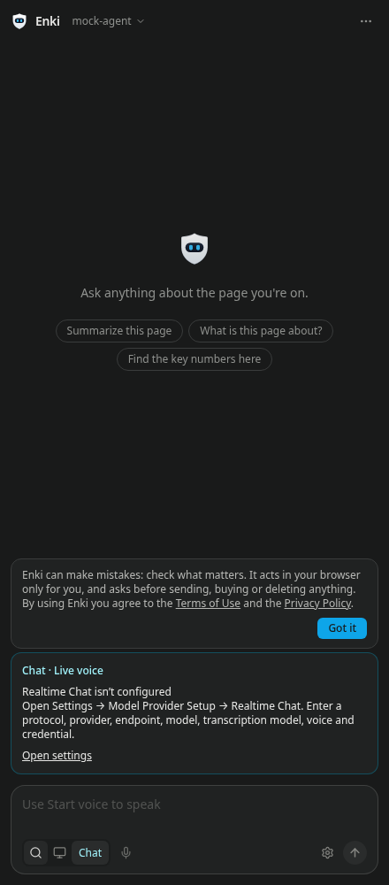
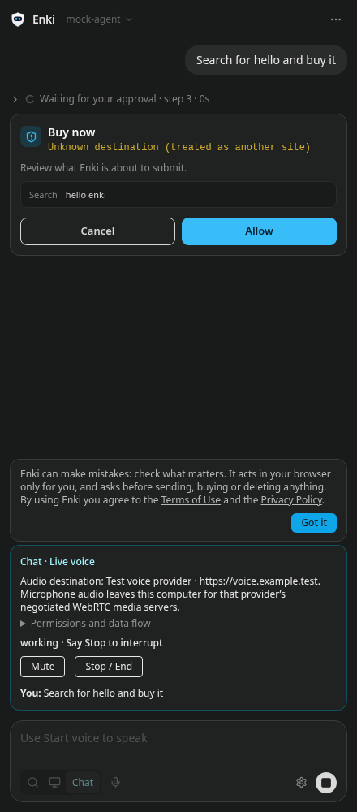
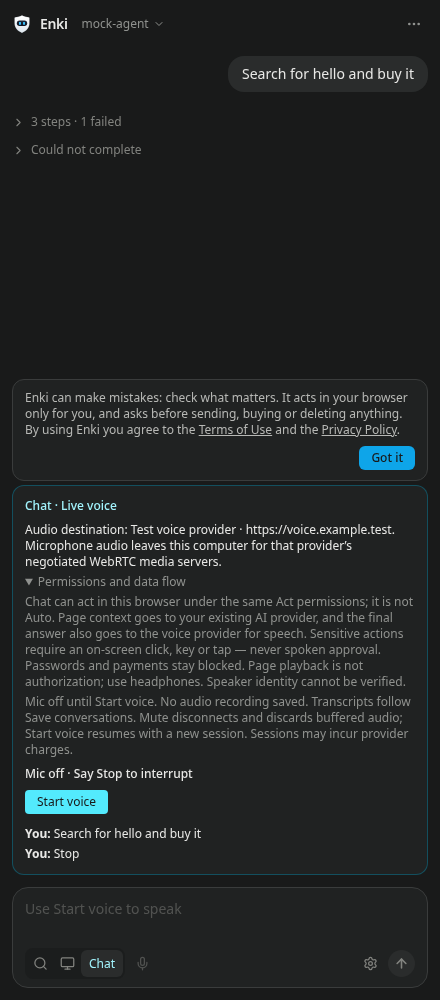
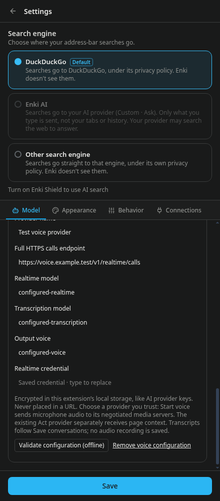
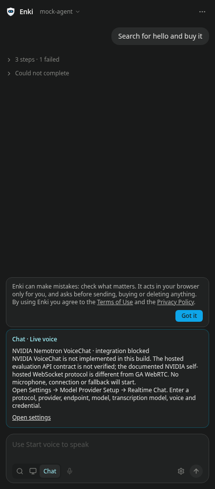
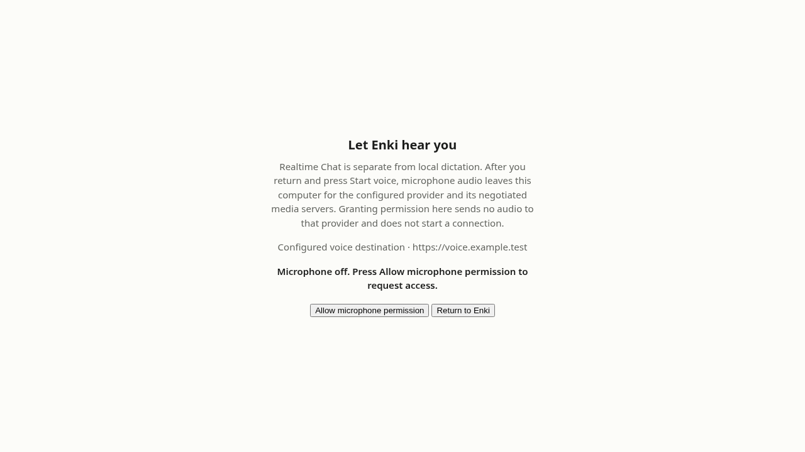

# Realtime Chat — development implementation (#120)

Not a release announcement. Live provider/microphone validation and security/visual review are still required.

NVIDIA is now visible as an explicitly **unimplemented, blocked capability**, not a preset or a working adapter. See [NVIDIA-VOICECHAT.md](./NVIDIA-VOICECHAT.md) for official API findings, hosted-access blockers, Portuguese status and the safe integration requirements.

## Setup and supported protocol

Settings → Model Provider Setup → **Realtime Chat**. For the implemented GA WebRTC adapter, all fields are user supplied:
provider label, protocol, full calls endpoint, realtime model, transcription model, output voice,
and credential. Nothing is inherited from the text provider, and no endpoint/model/vendor is selected by default.

The first adapter implements **OpenAI GA Realtime WebRTC**, specifically multipart
`POST /v1/realtime/calls` with `sdp` and `session`, Bearer header authentication,
GA `audio.input.transcription` / `audio.input.turn_detection`, an `oai-events` data channel,
completed input transcription events, out-of-band `response.create`, and media-track audio.
An endpoint must implement this actual protocol: an OpenAI-compatible chat-completions endpoint
is not enough. See the [official WebRTC guide](https://developers.openai.com/api/docs/guides/voice-webrtc?api=realtime)
and [Realtime client events](https://developers.openai.com/api/reference/resources/realtime/client-events).
The newer GPT-Live sessions protocol is different and is **not** implemented here.
For an OpenAI deployment, consult those docs for its current calls URL, supported model IDs,
transcription models and voice names, then enter them. No undocumented NVIDIA compatibility,
local Whisper+Ollama pipeline, automatic fallback, or universal realtime compatibility is claimed.

**Validate configuration (offline)** validates syntax only. It does not contact any provider,
check authentication or touch a microphone. The calls protocol cannot prove authentication
without starting a potentially billable realtime session; the UI says this explicitly.
No live key was supplied or used during development.

## User flow

Ask and Act remain unchanged. Chat selects a separate voice interface without connecting or
opening the mic. Missing configuration shows “Realtime Chat isn’t configured” and setup instructions.
Start voice explicitly requests microphone access after showing the destination and data flows.
The mic permission page is available via an explicit button if Chromium refuses the panel prompt. It receives only `purpose=realtime` in its URL and reads the configured destination from extension-local settings, never a key or raw endpoint in URL parameters. The page uses realtime-specific egress copy and requires a separate permission click; it stops tracks immediately and never connects to a provider. Return to Enki and press Start voice to begin. The existing dictation permission route keeps its distinct local-only copy.

The microphone streams to the chosen realtime provider. VAD completed utterances, not interim
transcript deltas, enter the **existing Act agent** using the existing text provider/model and browser
executor. This provides real browser tools through existing page fences and password/payment
blocks; the realtime peer receives **no browser tools** or raw page snapshots. The final Act answer
is also sent to that voice provider to generate speech. Completed transcript text stays visible.
The voice model is an audio renderer, not an autonomous browser-tool backend.

Voice cannot approve sensitive actions, change permissions or enable Auto. Sensitive cards must
be confirmed with the existing trusted mouse/keyboard/touch UI. Voice turns disable the generic
auto-approve toggle (a stricter subset of Act permissions), even if the user enabled it for typed Act.
Previously allowed plain navigation hosts retain their normal Act policy. Existing text providers
and stored settings are otherwise unchanged. Saved-task slash expansion is not applied to speech.

Barge-in cancels the active Act signal and clears speech output; only the newest committed
utterance can run after the old turn releases its locks. Saying **Stop** (English command), pressing
Stop/End, Escape, changing mode or opening Settings ends the session, stops capture/playback,
aborts queued/pending actions and ignores late events. Already executed actions are **not undone**.
Mute deliberately disconnects too: it stops actual tracks and discards buffered outgoing audio,
not just an indicator. Resume is a new explicit Start voice, with no replay or automatic reconnect.
If a physical browser command was already submitted when interrupted, its outcome must be inspected.

## Security and privacy review notes

- Direct Bearer authentication occurs only in the trusted extension panel, never a webpage,
  content script, query string, WebSocket subprotocol or proxy. The existing encrypted local
  storage mechanism protects the separate credential. Saved credentials are not rendered into
  the Settings input value until the user types a replacement.
- This is a single-user BYOM extension, **not** a web app distributing a project secret. The official
  web-app guide recommends a trusted backend/ephemeral tokens; do not reuse this extension code
  in a webpage. No credential-minting proxy or new service was added.
- HTTPS calls URLs only; userinfo, query strings, fragments and credential-bearing URLs are
  rejected. Fetch uses `redirect: "error"`, omitted cookies and no referrer. Errors are generic;
  provider bodies, SDP, transcripts and credentials are never sent to debug logs by this adapter.
- WebRTC audio travels to media servers negotiated by the selected provider, not necessarily
  the HTTPS API origin. No implicit vendor fallback, telemetry, audio recording, page-audio
  capture, or browser-history export. Review deployment WebRTC/UDP privacy restrictions with Blink.
- Microphone audio is not verified speaker identity. Headphones/echo cancellation reduce playback
  injection risk, but are **not** a security boundary; recorded audio or page playback must not
  be treated as authorization. Sensitive confirmation has no voice path. Do not claim reliable
  recognition of a human speaker.
- Realtime-generated text/tool events cannot dispatch actions. Only completed input transcripts
  associated with the current VAD item can start Act; duplicates/stale items are ignored.
- English UI and English Stop command only in this first adapter. pt/es voice UI localization
  remains pending; the existing typed-chat translations are untouched.

## Evidence and remaining release gates

`npm run test:realtime` exercises offline validation, explicit-start lifecycle, protocol payload,
credential redaction/redirect policy, Mute/End disposal, interruption and cancellation races,
late/duplicate events, disconnects, and the real Act loop cancellation gates.
`xvfb-run -a npm run test:realtime-ui` uses a mocked realtime peer/microphone in the built extension
with the real browser Act executor and local scripted text provider. It also runs the actual permission-page bundle with mocked getUserMedia to verify distinct route copy, safe destination display, no automatic capture/network and permission-only disposal. It is **not** a live provider test.

Before release: actual supported-account authentication and WebRTC negotiation, physical mic
permission/capture on Windows/macOS/Linux (including the real side panel), full spoken conversation,
remote speech playback, barge-in, Mute/End, action confirmation and Stop under latency/network loss;
CI green; Cloak security review; Ink build visual/a11y review; Blink packaging/privacy verification.
No version, merge, tag or release is created by this implementation PR.

## Mocked-browser screenshots (not a live audio test)

